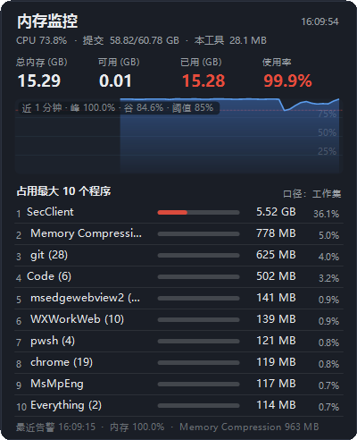

# MemTray — 托盘内存监控

[](LICENSE)

一个极轻量的 Windows 托盘小工具：右下角托盘图标实时反映内存使用率，左键弹出面板看总/可用/已用/使用率、近 30 分钟曲线和内存 Top10 进程；越线时自动记快照。

目的只有一个：**在电脑"突然变卡"的那一刻，自动留下现场**（是谁把内存吃掉了），而不是事后凭感觉猜。



---

## 一、日常怎么用

| 操作 | 效果 |
|------|------|
| 看托盘图标 | 圆环颜色 = 内存状态：绿色 < 70%，黄色 70–90%，红色 ≥ 90% |
| 鼠标悬停图标 | 提示 `内存 66.6% · 可用 5.11/15.29 GB` |
| **左键单击** | 弹出/收起监控面板（面板贴屏幕右下角） |
| 面板上按 Esc / 点别处 | 面板自动收起 |
| **右键单击** | 弹出菜单：内存摘要、CPU/提交、Top10（点击某项打开任务管理器）、打开面板、立即快照、复制最近告警、按专用内存统计、开机自启、打开日志目录、退出 |

### 面板内容

- 顶部：CPU 使用率、提交内存（已用/上限）、**本工具自身占用**
- 四个大数字：总内存(GB)、可用内存(GB)、已用内存(GB)、内存使用率(%)（使用率 ≥70% 变黄、≥90% 变红）
- 中部：内存使用率曲线（1 秒一个点，最多保留 30 分钟；横轴跨度自动从 1 分钟长到 30 分钟）+ 红色虚线 = 告警阈值
- 下部：**占用内存最大的 10 个程序**，带占比条与占比百分比（同名进程合并显示实例数，如 `chrome (19)`）
- 底部：最近一次告警摘要，或"暂无告警（使用率 ≥90% 或 可用 ≤1.5 GB，持续 10s）"

### 曲线怎么读

- 每个点 1 秒；横轴最近 30 分钟（还没攒够就自动缩短，左上角显示 `近 N 分钟 · 峰 x% · 谷 y% · 阈值 z%`）；纵轴 0–100%，25/50/75% 有刻度线，红色虚线 = 当前告警阈值。
- **斜坡上升** = 某个进程在持续吃内存（泄漏或缓存增长）；**垂直下落** = 一次性释放（进程退出/重启、自己清了缓存，或 Windows 在压力下把工作集换出到页面文件）。
- 注意：曲线掉下来不一定代表内存真的宽裕了。如果那个进程的**专用内存没降、只是工作集降了**，说明页只是被换到页面文件，机器照样卡。

---

## 二、自动告警与记录

满足任一条件并**持续 N 秒**（默认 10 秒，见 `config.ini` 的 `sustain_seconds`）即触发（避免瞬时毛刺误报）：

- 内存使用率 ≥ **90%**
- 可用物理内存 ≤ **1.5 GB**

触发后：托盘弹气泡 + 图标变红 + 立即抓 Top10 进程写 CSV。同一波占用只记一次，**两次告警最少间隔 300 秒**。

### 文件位置

| 文件 | 说明 |
|------|------|
| `%LOCALAPPDATA%\MemTray\logs\YYYY-MM-DD.csv` | 每天的告警快照（UTF-8 BOM，Excel 直接双击打开不乱码），**每个进程一行** |
| `%LOCALAPPDATA%\MemTray\config.ini` | 阈值配置（删掉即恢复默认） |
| `%LOCALAPPDATA%\MemTray\error.log` | 仅在出错时出现 |

CSV 列：

```
时间,原因,内存使用率%,已用GB,可用GB,提交已用GB,提交上限GB,排名,程序,实例数,工作集MB,专用MB,累计CPU秒
```

`原因` 为 `自动`（越线触发）或 `手动`（菜单"立即快照并记录"）。手动快照不弹告警气泡，只写文件。

### config.ini

```ini
alert_percent=90.0      # 使用率超过该值即视为越线
alert_avail_gb=1.5      # 可用物理内存低于该值即视为越线
sustain_seconds=10      # 越线持续多少秒才告警
cooldown_seconds=300    # 两次告警的最小间隔
metric=ws               # ws = 工作集（任务管理器"内存"列），private = 专用内存
```

改完**重启工具**生效（右键 → 退出，再双击 exe）。想让告警更敏感（更早抓到瞬时暴涨，代价是误报变多），可以把 `alert_percent` 调到 85、`alert_avail_gb` 调到 2.0、`sustain_seconds` 调到 2——截图里那台机器就是这么调的。想验证告警链路是否通，可临时把 `alert_percent` 改成 `0`、`sustain_seconds` 改成 `1`，几秒内就会生成当天 CSV，验证完记得删掉该文件恢复默认。

### 开机自启

右键菜单勾选「开机自启」即可（写 `HKCU\Software\Microsoft\Windows\CurrentVersion\Run` 的 `MemTray` 值，当前用户级，不需要管理员权限）。取消勾选即删除。

---

## 三、性能开销（实测）

| 场景 | 开销 |
|------|------|
| 常驻空闲（面板收起，只做 1 秒一次的内存汇总） | **≈0.01–0.03%**（8 逻辑核整机占比），工作集 15–35 MB / 专用 ~30 MB，约 340 个句柄、7–12 线程 |
| 面板打开时（每 2 秒枚举一次进程 + 重绘 10 行/曲线） | 约 **0.3–0.4%** 整机占比（枚举 400 个进程单次约 6.5 ms，剩余是自绘面板重绘），工作集升到 20–46 MB |
| 越线告警时 | 一次性抓 Top10 进程 + 追加几 KB CSV |

做法上的取舍：

- 汇总内存用 `GlobalMemoryStatusEx`（P/Invoke，约 0.06 ms），**不用 WMI**（`Get-CimInstance Win32_OperatingSystem` 约 35 ms，慢约 500 倍）。
- 进程枚举只在**面板可见**或**要写快照**时做，平时完全不遍历进程。
- 单文件 exe，无 .NET 运行时安装要求（用系统自带的 .NET Framework 4.8）。

---

## 四、把它用在"抓卡顿现场"上

1. 平时不用管它，托盘颜色变黄/红就是信号。
2. 觉得开始卡了，**先左键看一眼面板**的 Top10 和曲线斜率。
3. 如果卡的时候你没看（很常见），事后打开当天的 CSV：每次越线都有一整块记录，看 `排名 1` 那几行就知道那一刻是谁吃掉了内存，以及当时的 `累计CPU秒` 是不是也在疯涨。
4. 长期观察：把几天的 CSV 拉出来对比，反复出现的同一个程序 = 元凶（比如截图里那台机器的 `SecClient` 单进程吃到 5.98 GB 并伴随 3648 秒累计 CPU，同时还出现 `Memory Compression` 310 MB，说明物理内存已耗尽、系统在压缩/换页，这正是卡的直接原因）。

---

## 五、重新编译

无需安装 .NET SDK，用系统自带的 `C:\Windows\Microsoft.NET\Framework64\v4.0.30319\csc.exe`：

```powershell
git clone https://github.com/scoaming/MemTray.git
cd MemTray
pwsh -NoProfile -File .\build.ps1
```

脚本会先结束正在运行的实例（否则 exe 被占用无法覆盖），重画 `app.ico`，再编译出 `MemTray.exe`（约 36 KB）。

注意该 csc 只支持 **C# 5** 语法：不能用字符串插值、`?.`、`nameof`、表达式体成员、自动属性初始化器、`out var`；源码含中文必须带 `/codepage:65001`。

文件清单：

| 文件 | 作用 |
|------|------|
| `MemTray.cs` | 全部逻辑（约 1400 行，含自绘面板与托盘图标） |
| `app.manifest` | asInvoker + 启用 DPI 感知 + Win10/11 supportedOS |
| `build.ps1` | 生成图标 + 调 csc 编译 |
| `MemTray.exe` | 产物 |

也可以直接下载现成的 exe：[最新 Release](https://github.com/scoaming/MemTray/releases/latest)。

---

## 六、已知限制

- 只统计**进程级**内存，不含内核态/驱动占用（如 `Memory Compression`、非分页池）；面板里的"已用"来自系统汇总，通常略大于 Top10 之和，差额就是这些。
- 需要"以当前用户身份"运行（要访问 HKCU 自启键和写 `%LOCALAPPDATA%`），**不要**用管理员权限跑，否则任务管理器里会显示成另一个用户下的实例。
- 单实例：重复双击只会把已有实例的面板弹出来，不会起第二个进程。

---

## 七、License

MIT，见 [LICENSE](LICENSE)。随便用、随便改，保留版权声明即可。

